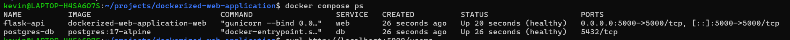
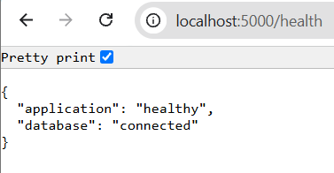
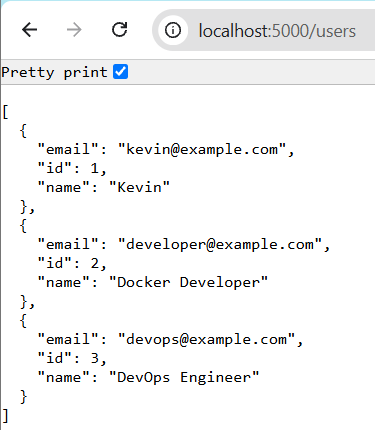
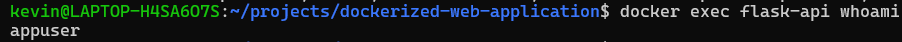

# Dockerized Web Application

A containerized REST API built with **Python Flask** and **PostgreSQL**, orchestrated using **Docker Compose**. This project demonstrates containerization, multi-stage Docker builds, database integration, persistent storage, health checks, and container security best practices.

## Architecture

```text
              Client
                |
                | HTTP :5000
                v
       +-------------------+
       |    Flask API      |
       |     Gunicorn      |
       |   Non-root User   |
       +-------------------+
                |
                | PostgreSQL :5432
                v
       +-------------------+
       |    PostgreSQL     |
       |     Database      |
       +-------------------+
                |
                v
       +-------------------+
       | Persistent Volume |
       +-------------------+
```

All services are managed by Docker Compose and communicate through a dedicated Docker bridge network.

## Tech Stack

- **Python 3.12**
- **Flask 3.1.2**
- **PostgreSQL 17**
- **Docker**
- **Docker Compose**
- **Gunicorn**

## Features

- Multi-stage Docker build to separate build and runtime environments.
- Lightweight Python runtime image.
- Non-root application user for improved container security.
- PostgreSQL database integration.
- Persistent named volume for database data.
- Docker bridge network for service communication.
- Container health checks.
- Automatic database initialization using `init.sql`.
- REST API endpoints for user management.

## Project Structure

```text
dockerized-web-application/
├── app/
│   ├── app.py
│   └── requirements.txt
├── database/
│   └── init.sql
├── screenshots/
│   ├── api-health.png
│   ├── api-users.png
│   ├── docker-compose-ps.png
│   └── docker-security.png
├── .dockerignore
├── .env.example
├── .gitignore
├── Dockerfile
├── docker-compose.yml
└── README.md
```

## Getting Started

### Prerequisites

- Docker Engine
- Docker Compose

### 1. Clone the repository

```bash
git clone https://github.com/Kevin-2603/dockerized-web-application.git

cd dockerized-web-application
```

### 2. Configure environment variables

```bash
cp .env.example .env
```

Edit `.env` and configure a strong PostgreSQL password.

```env
POSTGRES_DB=dockerapp
POSTGRES_USER=appuser
POSTGRES_PASSWORD=your_strong_password
```

**Important:** Never commit your `.env` file to GitHub.

### 3. Build and start containers

```bash
docker compose up -d --build
```

### 4. Verify container status

```bash
docker compose ps
```

Both services should report a healthy status.

### 5. Access the application

API base URL:

```text
http://localhost:5000
```

Health check:

```bash
curl http://localhost:5000/health
```

## API Endpoints

| Method | Endpoint | Description |
|---|---|---|
| GET | `/` | Application status |
| GET | `/health` | Application and database health |
| GET | `/users` | Retrieve all users |
| POST | `/users` | Create a new user |

### Example: Retrieve users

```bash
curl http://localhost:5000/users
```

### Example: Create a user

```bash
curl -X POST http://localhost:5000/users \
-H "Content-Type: application/json" \
-d '{"name":"DevOps Engineer","email":"devops@example.com"}'
```

## Screenshots

### Docker Compose Services



### API Health Check



### API Users



### Container Security



## Docker Commands

Stop containers:

```bash
docker compose down
```

View logs:

```bash
docker compose logs -f
```

View running containers:

```bash
docker compose ps
```

The PostgreSQL named volume is preserved when using `docker compose down`. Avoid `docker compose down -v` if you want to keep database data.

## Learning Outcomes

Through this project, I gained hands-on experience with:

- Building and managing Docker images.
- Creating multi-container applications.
- Configuring Docker networking.
- Managing persistent database storage.
- Implementing container health checks.
- Applying non-root container security.
- Deploying a Flask API with PostgreSQL using Docker Compose.

---

**Author:** [Kevin-2603](https://github.com/Kevin-2603)
